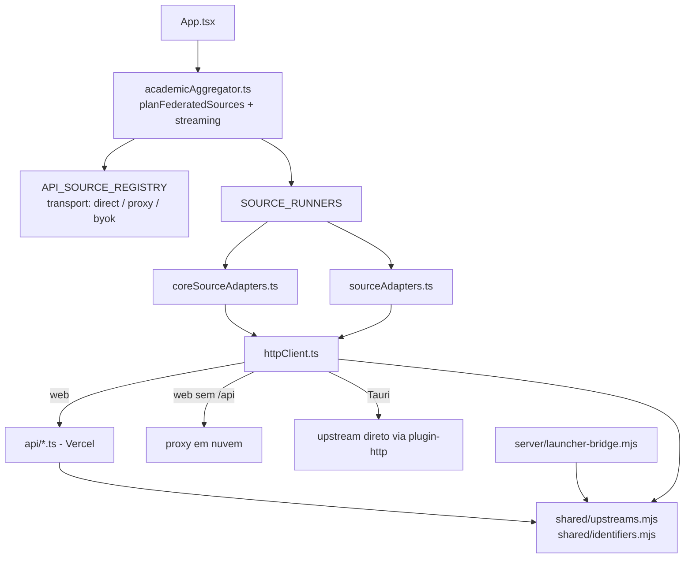

# Cartograph

Hub de metabusca científica, exploração bibliográfica e triagem sistemática PRISMA 2020. Roda em três modos com o mesmo frontend: **web** (Vercel, com funções serverless em `api/`), **web + bridge local** (Node em `server/launcher-bridge.mjs`) e **desktop nativo** (Tauri v2).

---

## Arquitetura

Frontend em **React 18 + TypeScript + Vite + Tailwind CSS**. A busca federada consulta em paralelo as fontes do registro `API_SOURCE_REGISTRY` (`src/data/apiSources.ts`) e cruza o resultado com um catálogo curado de plataformas (`src/data/platforms.ts`). Em novembro de 2026 o registro tem 27 fontes abertas e 7 que exigem chave do pesquisador (BYOK); os números exibidos na interface, no SEO e no cartão de compartilhamento são derivados desses registros no build.



Pontos de fonte única de verdade:

- **`shared/upstreams.mjs`** monta toda URL de API externa, caminho de proxy e requisição BYOK. É importado pelo cliente, pelas funções da Vercel e pelo bridge, então os três pedem exatamente o mesmo recurso.
- **`shared/identifiers.mjs`** normaliza DOI para deduplicação, proxy do Unpaywall, bridge e backups.
- **`SOURCE_RUNNERS`** (`src/services/sourceRunners.ts`) e **`API_SOURCE_DOCS`** (`src/data/apiSourceDocs.ts`) são `Record<ApiSourceId, …>` totais: registrar uma fonte sem adaptador ou sem documentação é erro de compilação.
- **`LAYOUT_STORAGE_KEYS`** (`src/utils/layoutPreferences.ts`) concentra as chaves de preferências visuais; os dados de pesquisa ficam em `WORKSPACE_STORAGE_KEYS` (`src/utils/storageEngine.ts`, IndexedDB).

### Política de rede (`src/services/httpClient.ts`)

| Runtime | Fontes com CORS | Fontes com proxy | Fontes BYOK |
| --- | --- | --- | --- |
| Web (Vercel) | direto | `/api/*` da mesma origem; erro do proxy é final | `/api/byok-proxy` da mesma origem |
| Web sem `/api` (Vite puro, hospedagem estática) | direto | proxy em nuvem (`VITE_CLOUD_PROXY_ORIGIN`), depois URL direta | indisponível: a chave não sai para outro host |
| Desktop (Tauri v2) | direto | direto via `@tauri-apps/plugin-http` | direto ao provedor via `plugin-http` |

---

## Modos de execução

### Desktop (Tauri v2 + Rust)

```bash
npm run desktop
```

```bash
npm run desktop:build
```

Launchers de duplo clique: `iniciar-desktop-mac.command`, `iniciar-desktop-windows.bat`, `./iniciar-desktop-linux.sh`.

### Web local + bridge

O bridge (porta padrão 4789, `BRIDGE_PORT`) replica as rotas de `api/` e abre várias abas pelo sistema operacional: `open` no macOS, `xdg-open` no Linux e `rundll32 url.dll,FileProtocolHandler` no Windows. O Windows não passa a URL pelo `cmd.exe`, cujo parser cortaria a URL no primeiro `&`.

```bash
npm start
```

Launchers de duplo clique: `iniciar-mac.command`, `iniciar-windows.bat`, `./iniciar-linux.sh`.

---

## Recursos

- **Busca federada com streaming:** resultados chegam por fonte, com diagnóstico de falha por fonte (limite de requisições, chave recusada, proxy indisponível).
- **Deduplicação determinística em 3 níveis** (DOI, PMID/arXiv, similaridade Jaro-Winkler) com inspeção das fusões; registros sem identificador recebem ID estável por hash, não aleatório.
- **Ranqueamento multicritério** (BM25, consenso entre fontes por RRF, impacto e recência, qualidade e acesso aberto) em `src/utils/relevanceRanker.ts`.
- **Construtor booleano e PICO/PECO/PCC**, sugestão de descritores MeSH e tradução de consultas PT → EN.
- **Biblioteca PRISMA 2020:** triagem com motivos padronizados, triagem cega com kappa de Cohen, avaliação de qualidade (RoB 2, JBI, CASP), bibliometria e diagrama de fluxo em SVG.
- **Exportação:** ABNT NBR 6023:2018, APA 7, BibTeX, RIS, Markdown e matriz CSV (UTF-8 com BOM).
- **Backup local em JSON** (schema v2) sem chaves de API nem credenciais de proxy. A tela de erro gera um backup de emergência no mesmo formato, reimportável pela Biblioteca, com registros ilegíveis guardados à parte.

---

## Internacionalização

Interface completa em português, inglês, espanhol e francês (`src/i18n/locales/*.ts`). Cada locale implementa a interface `Translations`; um teste verifica que todos têm as mesmas chaves e os mesmos placeholders `{param}`. Conteúdo longo (páginas Sobre, textos legais, cabeçalhos de exportação, diagrama PRISMA, descrições do catálogo) existe em português e inglês; nos demais idiomas aparece em inglês (`proseLanguage()` em `src/i18n/localized.ts`).

---

## Privacidade

Os dados de pesquisa ficam no navegador (IndexedDB, com fallback para localStorage). Métricas agregadas e sem cookies (Vercel Web Analytics e Speed Insights) podem ser desativadas em **Sobre › Privacidade**; a recusa também desliga eventos customizados e o Google Analytics, quando configurado.

---

## Scripts

| Comando | Função |
| --- | --- |
| `npm start` | Bridge + Vite com abertura do navegador |
| `npm run build` | Checagem de tipos (`tsc -b`) e build de produção |
| `npm test` | Testes unitários (`node:test`, compilados com esbuild) |
| `npm run og:render` | Regenera `public/og-image.png` a partir de `dist/og-image.svg` (rode após o build; usa Chrome headless) |

## Requisitos

- **Node.js** 20.11 ou superior (os scripts usam `import.meta.dirname`; a CI usa Node 22).
- **Rust e Cargo**, apenas para compilar o executável desktop.
