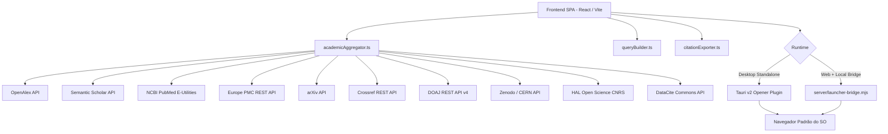

# Super Pesquisador 2000 (Nexus Acadêmico)

Hub federado de metabusca científica, exploração bibliográfica e exportação estruturada de literatura acadêmica. O sistema opera tanto em modo **Web + Bridge Local** quanto em **Janela Nativa Desktop Standalone (Tauri v2 + Rust)**.

---

## 📌 Visão Geral da Arquitetura

O sistema é construído sobre **React 18 + TypeScript + Vite + Tailwind CSS**, integrando consulta paralela assíncrona a 10 índices científicos abertos com formatação determinística de citações e abertura automatizada de links no navegador padrão com proteção anti-popups.



---

## 🚀 Modos de Execução

### 1. Modo Desktop Executável (Tauri v2 + Rust)
Executa o aplicativo em janela própria nativa, sem depender de abas do navegador web, com consumo de ~50 MB de memória RAM.

```bash
# Execução em modo desenvolvimento desktop
npm run desktop

# Compilação do executável final (.dmg/.app no macOS, .exe no Windows, .deb no Linux)
npm run desktop:build
```

Launchers de duplo clique:
- **macOS:** `iniciar-desktop-mac.command`
- **Windows:** `iniciar-desktop-windows.bat`
- **Linux:** `./iniciar-desktop-linux.sh`

---

### 2. Modo Web Local + Bridge de Sistema
Executa o frontend no Vite e o bridge HTTP leve (`server/launcher-bridge.mjs`) que despacha abas diretamente pelo SO (`open` no macOS, `start` no Windows, `xdg-open` no Linux).

```bash
# Inicia bridge + Vite simultaneamente
npm start
```

Launchers de duplo clique:
- **macOS:** `iniciar-mac.command`
- **Windows:** `iniciar-windows.bat`
- **Linux:** `./iniciar-linux.sh`

---

## 🔬 Cobertura de Fontes Científicas Integradas

1. **OpenAlex:** 250M+ registros, conceitos semânticos, contagem de citações e PDFs Open Access diretos.
2. **Semantic Scholar:** Análise de relevância por grafos, TL;DR gerado e métricas de citações influentes.
3. **PubMed (NCBI / NIH):** Busca biomédica em MEDLINE com resolução de PMID e PMC.
4. **Europe PMC:** Literatura biomédica e ciências da vida com resumos integrais.
5. **arXiv:** Preprints de Computação, Física, Matemática e áreas correlatas.
6. **Crossref:** Metadados oficiais de registros DOI e periódicos revisados por pares.
7. **DOAJ:** Catálogo de periódicos auditados em Acesso Aberto (Open Access).
8. **Zenodo (CERN / OpenAIRE):** Datasets, artigos e pacotes de replicação científica.
9. **HAL Open Science (CNRS):** Repositório acadêmico francês multidisciplinar.
10. **DataCite:** DOIs de dados empíricos de pesquisa, relatórios técnicos e preprints.

---

## 📑 Recursos e Utilitários

- **Construtor Booleano Avançado:** Geração guiada de operadores `AND`, `OR`, `NOT`, termos exatos e recorte temporal.
- **Dicionário Técnico Bilíngue:** Expansão automática de termos de busca Português ↔ Inglês.
- **Exportação Multiformato:**
  - Citações em **ABNT NBR 6023:2018**
  - Citações em **APA 7ª Edição**
  - Formato **BibTeX** para LaTeX / Overleaf
  - **Matriz de Revisão de Literatura em CSV** com codificação UTF-8 BOM (compatível com Excel e LibreOffice).
- **Internacionalização:** Suporte nativo e reativo a Português, Inglês, Espanhol e Francês.

---

## 🛠️ Requisitos de Desenvolvimento

- **Node.js** >= 18
- **Rust & Cargo** (necessários apenas para compilar o executável desktop via Tauri v2)
